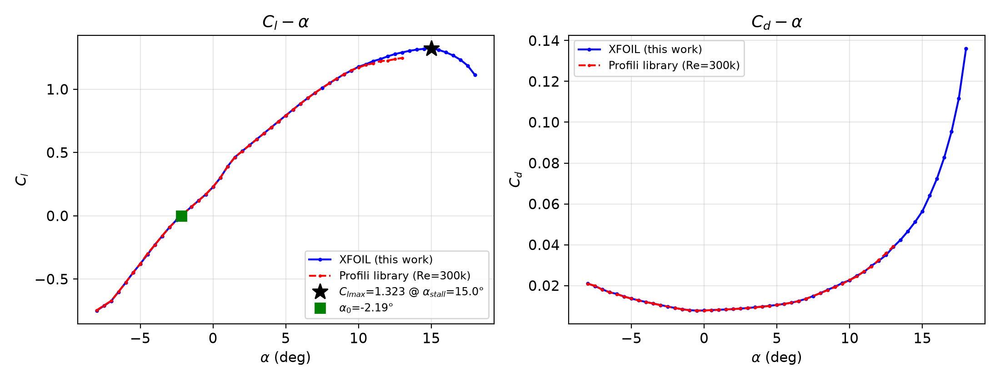

# profili-mcp

中文 | [English](README.en.md)

老牌翼型软件 [Profili 2.x](https://www.profili2.com/) 的 MCP 服务器。

[Profili](https://www.profili2.com/eng/) 是一款经典的翼型设计与分析软件（内置 2200+ 翼型、126 万条极曲线数据），开发已于 2015 年前后停止。它没有脚本 API，也没有 COM/OLE 自动化接口，所以本项目转而与它实际存在的三个接口打交道：

- Jet 数据库（`Profili.mdb`）——可读写，GUI 运行时同样可以访问
- 内嵌的 XFOIL 求解器——与 Profili 自身调用方式完全相同的批处理流程
- 应用程序进程——启动 / 关闭 / 状态检测

以上全部封装为 14 个 MCP 工具。据我所知这是首个面向 Profili 的 MCP 服务器；使这一切成为可能的存储格式逆向结论记录在 [docs/SCHEMA.md](docs/SCHEMA.md) 中。



*实战示例（[examples/](examples/)）：NACA 2412，Re=3×10⁵，计算极曲线与软件内置库极曲线对比。*

## 工具一览

| 工具 | 功能 |
|---|---|
| `get_status` | 探测安装：路径、数据库行数、GUI 状态 |
| `launch_profili` / `close_profili` | 启动 / 关闭 Profili GUI |
| `list_libraries` | 列出翼型库 |
| `search_airfoils` | 按名称 / 厚度 / 弯度 / 库筛选翼型 |
| `get_airfoil_geometry` | 元数据 + 上下表面坐标（弦长分数，前缘→后缘） |
| `export_airfoil_dat` | 导出 `.dat` 坐标文件 |
| `import_airfoil_dat` | 导入 `.dat` 进翼型库（自动备份） |
| `list_polars` | 查询某翼型已有的极曲线雷诺数 |
| `get_polar` | 读取存储极曲线（CL/CD/CM-α，SI 单位） |
| `find_airfoils_by_polar` | 按指定雷诺数、攻角下的气动性能筛选翼型 |
| `analyze_airfoil` | 用内嵌 XFOIL 现算粘性极曲线，可写回翼型库 |
| `analyze_naca` | 直接计算任意 NACA 4/5 位数翼型，不动数据库 |
| `redesign_airfoil` | XFOIL GDES TSET 修改最大厚度 / 弯度，可另存新翼型 |

## 安装

要求：Windows、已安装的 Profili 2.x（`Profili.exe`、`Profili.mdb`、`Xfoil.exe` 位于同一目录）、以及 32 位 `Microsoft Access Driver (*.mdb)` ODBC 驱动（Win10/11 通常自带；缺失时安装 [MDAC](https://www.microsoft.com/en-us/download/details.aspx?id=5793)）。

```bash
git clone https://github.com/GaillumXc/profili-mcp.git
cd profili-mcp
uv sync          # 或 pip install .
```

告诉服务器 Profili 的安装位置——环境变量，或作为 `install_dir` 参数传给任意工具：

```bash
set PROFILI_DIR=D:\path\to\ProfiliV2
python -m profili_mcp --selftest     # 全链路自检：数据库 + 数值约定 + XFOIL
```

## MCP 客户端配置

```json
{
  "mcpServers": {
    "profili": {
      "command": "python",
      "args": ["-m", "profili_mcp"],
      "env": { "PROFILI_DIR": "D:\\path\\to\\ProfiliV2" }
    }
  }
}
```

适用于 Kimi Code、Claude Desktop、Cursor 及任何支持 stdio MCP 的客户端。

## 安全设计

- 写库前自动备份 `Profili.mdb`（同目录时间戳副本）；`backup=False` 可关闭。
- GUI 运行时数据库保持可读写，但界面不会自动刷新——导入翼型或保存极曲线后重启 Profili 即可看到。
- 极曲线写入使用与 Profili 自带库导入完全一致的表结构（`PolariHeader` + `PolariCoordinate`）。

## 示例

[examples/](examples/) 是一个完整的实战分析（NACA 2412，Re=3×10⁵）：库中取几何 → 计算极曲线 → 提取参数（`C_lmax` 1.3234、`α_stall` 15.0°、`α₀` −2.19°、`C_m0` −0.0499），曲线与内置库存极曲线及教科书数值均吻合。

```
python examples/analysis_compute.py && python examples/analysis_naca2412.py
```

## 相关项目

- [Three-Little-Birds/xfoil-mcp](https://github.com/Three-Little-Birds/xfoil-mcp)、[Saxeman/xfoil-mcp](https://github.com/Saxeman/xfoil-mcp) —— 面向裸 XFOIL 的 MCP 服务器；不接触 Profili 翼型库与数据库。
- [YanYaoyuan/passwing](https://github.com/YanYaoyuan/passwing) —— 可导入 `Profili.mdb` 的 Qt/C++ 气动套件；桌面软件，非智能体接口。
- [devFoil / devWing](https://www.devcad.com) —— 作者后续开发的商业软件系列，Profili 的继任者。

## 已知问题

- **非 ASCII 项目路径 + editable 安装**：CPython 以系统 locale 编码读取 `.pth` 文件，因此当 clone 路径含非 ASCII 字符时 editable 安装会失败。请 clone 到纯英文路径，或以 `PYTHONPATH=src python -m profili_mcp` 方式运行。
- 本仓库不包含 Profili 软件本体（商业软件，已停止开发）；项目只与已安装的副本交互。

## 作者与验证范围

账号所有者（[GaillumXc](https://github.com/GaillumXc)）为**无人驾驶航空器系统工程**专业本科在读学生，本项目是课程学习过程中的个人作品。**全部功能仅在 Profili 2.21 单一版本上验证过**；其他版本（2.0/2.2x 各修订、XT、Pro 等）未做测试，行为可能存在差异，欢迎提交 issue 反馈。Kimi K2.8（Moonshot AI 编程助手）参与了逆向分析、代码、文档与示例的编写，提交按 `Co-authored-by` 惯例署名。

## License

MIT，见 [LICENSE](LICENSE)。Profili 为 devCAD / Stefano Nardone 的商业软件，权利归原作者所有；XFOIL 由 Mark Drela 开发并随 Profili 捆绑分发。本项目仅供个人学习与研究。
