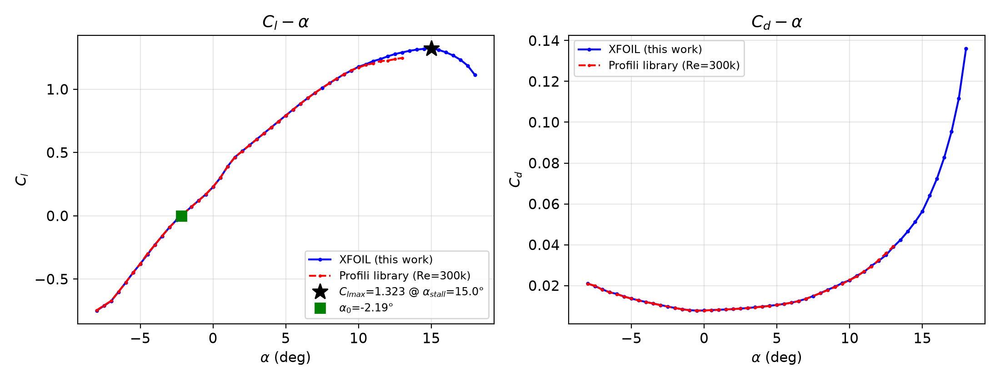
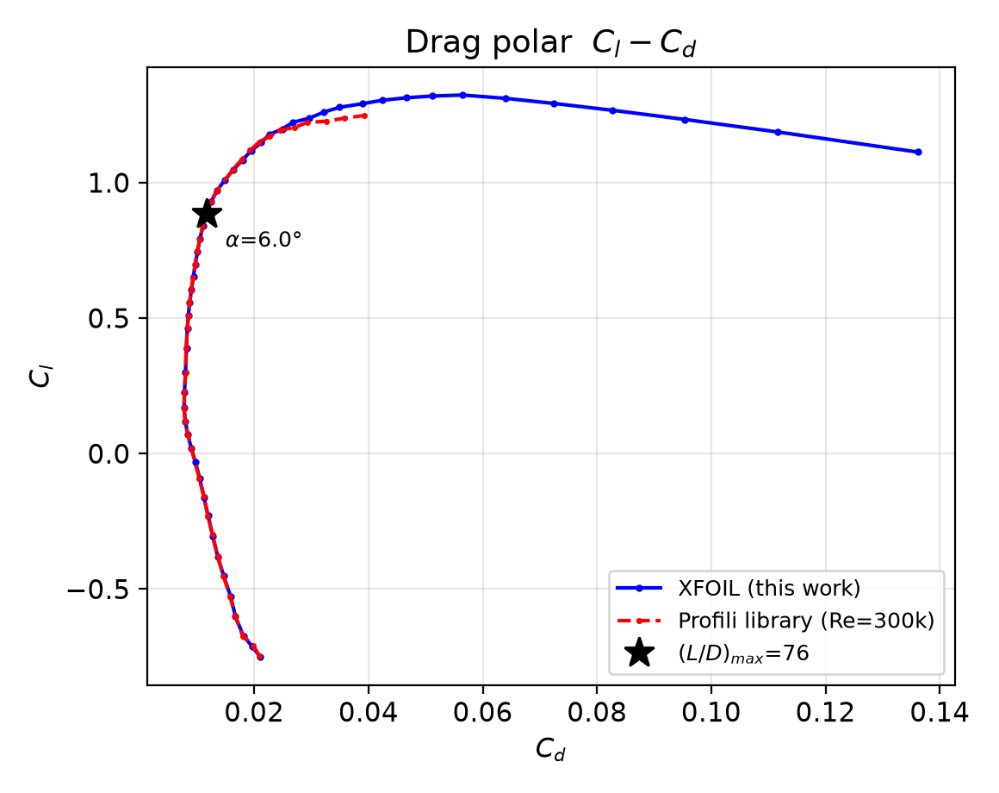

# 实战示例：NACA 2412 极曲线分析

这个示例用 profili-mcp 的核心库（不经过 MCP 协议，直接 import）完整复现了一次
真实课程作业：从 Profili 翼型库读取 NACA 2412 → 用 Profili 内嵌 XFOIL 求解器
计算粘性极曲线 → 提取特征参数 → 出图。

## 运行

```bash
# 1. 计算（需要本机装有 Profili 2.x，并设置 PROFILI_DIR）
python analysis_compute.py      # 输出 naca2412_data.json

# 2. 出图 + 提取参数（需要 matplotlib）
python analysis_naca2412.py     # 输出 PNG + CSV + parameters.json
```

## 计算条件

Re = 3×10⁵，Ma = 0，Ncrit = 9，α = -8°~18°（步长 0.5°），
坐标取自 Profili 翼型库 NACA 2412（t/c = 12%）。

## 结果





| 参数 | 数值 |
|---|---|
| C_lmax | 1.3234（α = 15.0°） |
| α_stall | 15.0° |
| α_0 | -2.19° |
| C_m0 (α=0°) | -0.0499 |
| C_dmin | 0.00775（α=-0.5°） |
| (L/D)_max | 76.2（α=6.0°） |

与 Abbott & von Doenhoff 经典数据（α₀≈-2.1°，C_m,ac≈-0.053）吻合；
与 Profili 自带库存极曲线（Re=300k）线性段几乎完全重合。

图中蓝色实线为本例计算结果，红色虚线为 Profili 翼型库存储极曲线（对比验证）。
